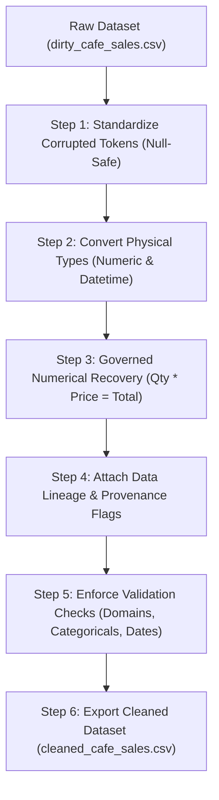

# Task 1: Data Cleaning & Preprocessing Report
**Project:** Data Analytics Internship — Task 1  
**Dataset:** Cafe Sales Transaction Records (`dirty_cafe_sales.csv`)  
**Canonical Source:** [Kaggle Dataset: Cafe Sales - Dirty Data for Cleaning Training](https://www.kaggle.com/datasets/ahmedmohamed2003/cafe-sales-dirty-data-for-cleaning-training) by Ahmed Mohamed (`ahmedmohamed2003`)  
**License:** Unspecified / Unknown  
**Auditor / Analyst:** Antigravity AI Coding Assistant  
**Date:** November 2026  
**Status:** Completed & Validated  

---

## 1. Introduction and Objectives

Data cleaning is a foundational stage in data analytics. Real-world business data frequently suffers from corrupted characters, missing observations, type mismatches, and broken relational constraints. If unaddressed, these defects compromise subsequent exploratory data analysis, business intelligence dashboards, and predictive modeling.

### Core Objectives:
1. **Diagnostic Assessment:** Systematically inspect the raw transaction records to detect explicit nulls (`NaN`), pseudo-missing sentinel strings (`ERROR`, `UNKNOWN`), type corruptions, and structural anomalies.
2. **Standardization & Type Enforcement:** Normalize corrupted tokens into standard missing values via null-safe transformations and cast columns into their native physical types (nullable integer, floating-point, datetime, and categorical string).
3. **Mathematically Governed Numerical Recovery:** Leverage the enterprise constraint $\text{Quantity} \times \text{Price Per Unit} = \text{Total Spent}$ to recover missing values safely without guessing.
4. **Data Provenance Tracking:** Implement granular boolean audit flags to track data lineage, ensuring analysts can separate raw ground truth from algorithmically inferred values.
5. **Governance & Licensing Integrity:** Avoid fabricating categorical values, avoid arbitrary row deletions, and preserve the original raw dataset in an immutable state.

---

## 2. Dataset Description, Source & Licensing Disclosure

* **File Name:** `dirty_cafe_sales.csv`
* **Local Raw Path:** `Task_1_Data_Cleaning/data/raw/extracted/dirty_cafe_sales.csv` (downloaded locally from Kaggle; excluded from version control)
* **Local Cleaned Path:** `Task_1_Data_Cleaning/data/cleaned/cleaned_cafe_sales.csv` (generated locally via pipeline; excluded from version control)
* **Canonical Source:** [Kaggle Dataset: Cafe Sales - Dirty Data for Cleaning Training](https://www.kaggle.com/datasets/ahmedmohamed2003/cafe-sales-dirty-data-for-cleaning-training)
* **License:** **Unspecified / Unknown**
* **Volume:** 10,000 observations, 8 initial features.
* **Domain Context:** Point-of-Sale (POS) cafe sales transactions recorded daily across the calendar year 2023 (from `2023-01-01` to `2023-12-31`).

### Disclosure of Synthetic Nature & Local Scope:
> **Synthetic Dataset & Local Scope Disclosure:**  
> This dataset is an intentionally corrupted synthetic dataset curated for training and assessing data cleaning capabilities in data analytics internships. It models common real-world POS data collection issues, including software export glitches (rendering numerical values as strings like `"ERROR"` and `"UNKNOWN"`), incomplete cashier records, and missing payment channels. While synthetic, its relational constraints ($\text{Quantity} \times \text{Price} = \text{Total}$) and menu pricing architecture reflect authentic retail transactional dynamics.
> 
> **Licensing & Scope Statement:** This report documents the analytical methodology, quality findings, and automated validation suite executed **locally** on the downloaded dataset. In compliance with intellectual property standards and the unspecified upstream license, neither the original raw data nor the derivative cleaned dataset is redistributed or hosted within this public repository.

### Initial Attributes Schema:
| Variable Name | Raw Data Type | Expected Logical Type | Description |
| :--- | :--- | :--- | :--- |
| `Transaction ID` | `object` (string) | String / Identifier | Unique alphanumeric receipt code (`TXN_xxxxxxx`) |
| `Item` | `object` (string) | Categorical String | Menu product sold (8 discrete items) |
| `Quantity` | `object` (string) | Nullable Integer (`Int64`) | Units purchased per transaction ($1 \le Q \le 5$) |
| `Price Per Unit` | `object` (string) | Float (`float64`) | Fixed price per individual unit in USD (\$) |
| `Total Spent` | `object` (string) | Float (`float64`) | Total gross monetary value of the sale in USD (\$) |
| `Payment Method` | `object` (string) | Categorical String | Transaction settlement channel (`Cash`, `Credit Card`, `Digital Wallet`) |
| `Location` | `object` (string) | Categorical String | Consumption channel (`In-store`, `Takeaway`) |
| `Transaction Date` | `object` (string) | Datetime (`datetime64[ns]`) | Date of transaction in ISO 8601 (`YYYY-MM-DD`) |

---

## 3. Tools and Libraries

The cleaning pipeline and audit were constructed in a specialized **Python 3.13** scientific environment:
* **Pandas (v3.1.0):** Used for tabular dataframe operations, nullable integer types (`Int64`), vector arithmetic, and CSV input/output.
* **NumPy (v2.5.4):** Used for missing value representations (`np.nan`) and mathematical validation thresholds.
* **Matplotlib (v3.11.2) & Seaborn (v0.13.2):** Used for generating distribution charts and data corruption profiles.
* **IPython & Jupyter:** Used for interactive, reproducible execution and documentation.
* **Standard Library (`os`, `sys`, `hashlib`, `zipfile`):** Used for file integrity checks and SHA-256 cryptographic hashing.

---

## 4. Initial Dataset Inspection

Initial inspection revealed that the raw CSV loaded with **all 8 columns typed as `object` (text)**. This occurred because software export errors inserted literal text strings (`"ERROR"` and `"UNKNOWN"`) into columns that should otherwise be strictly numeric or dates.

### Initial Summary Statistics:
* **Total Records:** 10,000 rows
* **Total Features:** 8 columns
* **Duplicate Rows:** Exactly 0 duplicate rows across all columns.
* **Transaction ID Uniqueness:** Exactly 10,000 unique transaction IDs (100% unique primary key).
* **Date Span:** 9,540 valid date strings spanning from `2023-01-01` to `2023-12-31`.

---

## 5. Data Quality Issues Discovered

The assessment revealed a **dual-layer missingness problem**: standard missing values (`NaN`) were accompanied by literal placeholder strings (`"ERROR"` and `"UNKNOWN"`) that bypassed standard `df.isnull()` checks.

### Comprehensive Raw Data Quality Matrix ($N = 10,000$):
| Feature | Standard `NaN` | `'ERROR'` Strings | `'UNKNOWN'` Strings | Total Dirty Records | Dirty Percentage (%) |
| :--- | :---: | :---: | :---: | :---: | :---: |
| `Transaction ID` | 0 | 0 | 0 | **0** | **0.00%** |
| `Item` | 333 | 292 | 344 | **969** | **9.69%** |
| `Quantity` | 138 | 170 | 171 | **479** | **4.79%** |
| `Price Per Unit` | 179 | 190 | 164 | **533** | **5.33%** |
| `Total Spent` | 173 | 164 | 165 | **502** | **5.02%** |
| `Payment Method` | 2,579 | 306 | 293 | **3,178** | **31.78%** |
| `Location` | 3,265 | 358 | 338 | **3,961** | **39.61%** |
| `Transaction Date` | 159 | 142 | 159 | **460** | **4.60%** |

### Key Observations:
1. **Severe Categorical Vacancy:** `Location` is missing/corrupted in 39.61% of records, and `Payment Method` is missing/corrupted in 31.78% of records.
2. **Fixed Menu Pricing Structure:** Cross-tabulation of `Item` vs. `Price Per Unit` on clean records confirmed that each menu product has a deterministic, constant unit price:
   * **Salad:** \$5.0
   * **Sandwich:** \$4.0
   * **Smoothie:** \$4.0
   * **Cake:** \$3.0
   * **Juice:** \$3.0
   * **Coffee:** \$2.0
   * **Tea:** \$1.5
   * **Cookie:** \$1.0
3. **Shared Price Tiers:** While each item has one price, multiple items share identical prices (\$4.0 for Sandwich and Smoothie; \$3.0 for Cake and Juice).
4. **Mathematical Determinism:** On all 8,544 raw rows where `Quantity`, `Price Per Unit`, and `Total Spent` were all valid numbers, $\text{Quantity} \times \text{Price} = \text{Total}$ held with exactly **0 discrepancies**.

---

## 6. Cleaning Methodology

The cleaning pipeline was structured into modular, reproducible stages implemented in `cleaning.py`:



### 6.1 Standardization of Sentinel Tokens (Null-Safe Normalization)
All corrupted sentinels are unified under a single shared constant set:
$$\text{SENTINEL\_TOKENS} = \{\text{'ERROR'}, \text{'UNKNOWN'}, \text{'NAN'}, \text{'NONE'}, \text{'NULL'}, \text{'NA'}, \text{'?'}\}$$

**Null-Safe Implementation:** Rather than applying `.astype(str)` indiscriminately across columns (which would coerce genuine `NaN` values into string `'nan'`), the function operates strictly on non-null masks:
1. Isolate non-null entries: `mask_notnull = df[col].notnull()`.
2. Strip whitespace and upper-case for comparison: `series_notnull.str.upper().isin(SENTINEL_TOKENS) | (series_notnull == '')`.
3. Existing nulls remain untouched; matched sentinels and empty strings are converted to `np.nan`.
4. The exact same definition is utilized in both `standardize_missing_tokens()` and `print_cleaning_summary()`, ensuring mathematical reporting consistency.

### 6.2 Data Type Conversion
* `Quantity` was converted to numeric (`float64` temporarily during calculation, then cast to nullable `Int64`).
* `Price Per Unit` and `Total Spent` were converted to `float64`.
* `Transaction Date` was parsed using ISO format `%Y-%m-%d` into `datetime64[ns]`.

---

## 7. Numerical Recovery Methodology

Numerical recovery was conducted strictly using the enterprise mathematical relationship:
$$\text{Total Spent} = \text{Quantity} \times \text{Price Per Unit}$$

### Mathematical Recovery Rules & Domain Guards:
1. **Quantity Recovery ($\hat{Q} = \frac{\text{Total Spent}}{\text{Price Per Unit}}$):**
   * **Condition:** `Quantity` is missing; both `Price Per Unit` and `Total Spent` are valid and non-null.
   * **Domain Constraint:** Inferred value must be an exact positive integer within $[1, 5]$ ($\hat{Q} \pmod 1 = 0$ and $1 \le \hat{Q} \le 5$).
   * **Result:** **441 values successfully recovered**.
2. **Total Spent Recovery ($\hat{T} = \text{Quantity} \times \text{Price Per Unit}$):**
   * **Condition:** `Total Spent` is missing; both `Quantity` and `Price Per Unit` are valid and non-null.
   * **Domain Constraint:** Inferred value must be strictly positive ($\hat{T} > 0$).
   * **Result:** **462 values successfully recovered**.
3. **Price Per Unit Recovery ($\hat{P} = \frac{\text{Total Spent}}{\text{Quantity}}$):**
   * **Condition:** `Price Per Unit` is missing; both `Quantity` and `Total Spent` are valid and non-null.
   * **Domain Constraint:** Inferred value must strictly belong to the recognized menu pricing set $\{1.0, 1.5, 2.0, 3.0, 4.0, 5.0\}$.
   * **Result:** **495 values successfully recovered**.

### Why Chained Imputations Were Prohibited:
Chained imputation (e.g., using an imputed `Price Per Unit` to immediately infer a missing `Quantity` on the same row) was strictly prevented. Each recovery equation requires that the other two values are already valid and non-null. As proven in the independent audit, it is mathematically impossible for any row to trigger more than one numerical recovery rule.

---

## 8. Missing Value Treatment & Conservative Governance

A core principle of responsible data analytics is **transparency over cosmetic completeness**:

### Categorical Values (`Item`, `Payment Method`, `Location`):
* **No Invented Categorical Data:** We strictly avoided mode imputation or synthetic random assignment for `Payment Method` (31.78% missing) and `Location` (39.61% missing). Imputing payment methods or store channels would artificially distort customer behavioral distributions and invalidate downstream sales mix analytics.
* **No Price-to-Item Guessing:** Because Cake and Juice share the \$3.0 price tier, and Sandwich and Smoothie share the \$4.0 tier, imputing `Item` from price alone would fabricate arbitrary menu choices.
* **Transparent Null Retention:** Unresolved categorical values are preserved as genuine missing values (`NaN` in memory, empty strings in CSV) without deleting rows.

---

## 9. Data Provenance Tracking

To maintain data lineage, three boolean audit columns were introduced:
* `is_quantity_imputed`: `True` if `Quantity` was mathematically recovered; `False` if observed.
* `is_price_imputed`: `True` if `Price Per Unit` was mathematically recovered; `False` if observed.
* `is_total_imputed`: `True` if `Total Spent` was mathematically recovered; `False` if observed.

### Provenance Distribution ($N = 10,000$):
* `is_quantity_imputed == True`: **441 rows** (4.41%)
* `is_price_imputed == True`: **495 rows** (4.95%)
* `is_total_imputed == True`: **462 rows** (4.62%)
* **Total Recovered Numerical Values:** **1,398 values** across 1,398 distinct transactions.
* **Multiple Imputations per Row:** **0 rows** (100% mutually exclusive).

---

## 10. Before-and-After Cleaning Comparison

```text
================================================================================
               DATA CLEANING BEFORE-AND-AFTER SUMMARY
================================================================================
          Column Raw Dirty (NaN+Tokens) Cleaned Missing Recovered / Fixed Clean Data Type
  Transaction ID               0 (0.0%)        0 (0.0%)                 0             str
            Item             969 (9.7%)      969 (9.7%)                 0             str
        Quantity             479 (4.8%)       38 (0.4%)               441           Int64
  Price Per Unit             533 (5.3%)       38 (0.4%)               495         float64
     Total Spent             502 (5.0%)       40 (0.4%)               462         float64
  Payment Method          3,178 (31.8%)   3,178 (31.8%)                 0             str
        Location          3,961 (39.6%)   3,961 (39.6%)                 0             str
Transaction Date             460 (4.6%)      460 (4.6%)                 0  datetime64[us]
================================================================================
```

### Key Numerical Improvements:
* **Fully Populated Numerical Triads:** Increased from **8,544 rows (85.44%)** in the raw data to **9,942 rows (99.42%)** in the cleaned data.
* **Numerical Deficit Reduction:** Residual missingness in numerical features dropped to just **0.38% – 0.40%**.
* **Zero Row Deletions:** All 10,000 original observations were preserved.

---

## 11. Validation Results

An automated suite of rigorous validation tests was executed following data cleaning. All passed with 100% compliance:

1. **Transaction ID Uniqueness:** 10,000 unique keys out of 10,000 records (`df['Transaction ID'].nunique() == 10000`).
2. **Quantity Domain Integrity:** 100% of non-null quantities evaluate to integers in $\{1, 2, 3, 4, 5\}$.
3. **Price Domain Integrity:** 100% of non-null unit prices belong to $\{1.0, 1.5, 2.0, 3.0, 4.0, 5.0\}$.
4. **Item Category Validation:** 100% of non-null items belong to the 8 expected menu categories (`Salad`, `Sandwich`, `Smoothie`, `Cake`, `Juice`, `Coffee`, `Tea`, `Cookie`) across 9,031 observed records (0 unexpected categories).
5. **Payment Method Category Validation:** 100% of non-null payment methods belong to `{'Cash', 'Credit Card', 'Digital Wallet'}` across 6,822 observed records (0 unexpected categories).
6. **Location Category Validation:** 100% of non-null locations belong to `{'Takeaway', 'In-store'}` across 6,039 observed records (0 unexpected categories).
7. **Item-Price Alignment:** 100% agreement across all 8,999 co-present pairs (0 contradictions).
8. **Mathematical Determinism:** Re-calculating $\text{Quantity} \times \text{Price} - \text{Total}$ across all 9,942 fully populated rows produced a maximum discrepancy of **`0.0`** (0 discrepancies $> 10^{-4}$).
9. **Date Parsing & Missingness Transparency:** Certified 9,540 valid timestamps spanning `2023-01-01` to `2023-12-31`, while explicitly reporting the **460 remaining missing dates (4.60%)**.

---

## 12. Limitations and Remaining Missing Values

### Why Unrecoverable Values Were Retained:
A total of **58 rows** remain incomplete in their numerical columns:
* **20 rows:** `Quantity` is observed, but both `Price Per Unit` and `Total Spent` are missing.
* **20 rows:** `Total Spent` is observed, but both `Quantity` and `Price Per Unit` are missing.
* **18 rows:** `Price Per Unit` is observed, but both `Quantity` and `Total Spent` are missing.

**Reason for Retention:**  
In all 58 cases, an equation with one known and two unknowns ($\text{Total} = Q \times P$) is mathematically underdetermined. Inferring values would require arbitrary assumptions regarding customer basket size or item selection. Retaining these records as nulls preserves statistical integrity and avoids fabricating data.

### Categorical & Temporal Deficits:
* `Item` retains 969 missing records (9.69%).
* `Payment Method` retains 3,178 missing records (31.78%).
* `Location` retains 3,961 missing records (39.61%).
* `Transaction Date` retains 460 missing records (4.60%).

---

## 13. Conclusion

Task 1 established a reproducible, fully audited data cleaning pipeline. By leveraging enterprise mathematical constraints and domain price mappings, **1,398 corrupted numerical values were recovered with zero errors**, expanding complete financial transaction records to **99.42%**. Crucially, this was achieved without fabricating categorical information, without chained assumptions, without overwriting observed ground truth, and while maintaining complete data lineage via provenance tracking. The cleaned dataset is ready for downstream analytical workflows.
